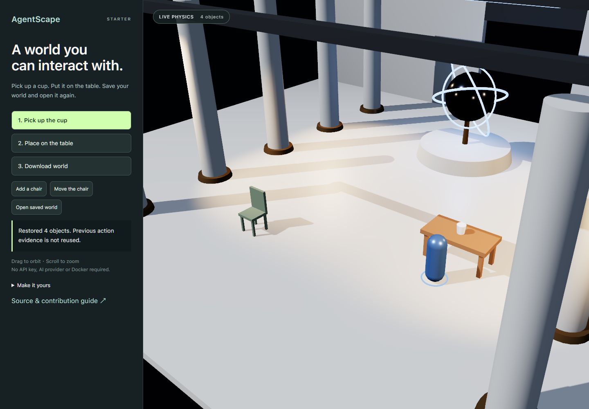

# AgentScape

**Build interactive 3D worlds that people and AI agents can operate.**

Three.js rendering, Rapier physics and Recast navigation share one world state. Characters can walk to objects, pick them up and place them on surfaces. The runtime reports what actually happened, separately from what was requested.

[Live Studio](https://agentscape-virid.vercel.app/) · [Live Starter](https://agentscape-virid.vercel.app/starter/) · [简体中文](README.zh-CN.md) · [First world](apps/starter/README.md) · [MCP for AI agents](apps/mcp-server/README.md) · [Contribute](CONTRIBUTING.md)



## Run your first world

Use Node.js 22.12+ (Node 22 is used in CI), npm and a browser with WebGL2 support.

```sh
git clone https://github.com/xiaoqianran/AgentScape.git
cd AgentScape
npm ci
npm run starter
```

Open the `/starter/` URL printed by Vite, normally `http://127.0.0.1:5173/starter/`.

1. Click **Pick up the cup**, then **Place on the table**. Wait for each verified result.
2. Add a chair and move it.
3. Download the world, reload the page, and open the saved JSON file.

The starter uses bundled assets: **no model API key, generation service or Docker required**. Package installation needs internet access. A public static preview is available on Vercel: [Studio](https://agentscape-virid.vercel.app/), [Starter](https://agentscape-virid.vercel.app/starter/), [Home](https://agentscape-virid.vercel.app/home/) and [Observatory](https://agentscape-virid.vercel.app/observatory/). The preview does not expose the private MCP server or optional local generation services.

## Make it yours

Edit [`apps/starter/scene.json`](apps/starter/scene.json) and reload. Your scene is a real, version-controlled file. The starter currently accepts `agent`, `cup`, `table` and `chair` assets.

```json
{ "id": "reading-chair", "asset": "chair", "position": [-4, 0, 3] }
```

The `agentscape3d` SDK shares the Scene service with Studio and MCP. The `2.0.0-beta.1` package is being prepared for npm; until publication, [build a local tarball](sdk/typescript/README.md). After publication, install with `npm install agentscape3d`.

```js
import { AgentScape } from 'agentscape3d';
const world = await AgentScape.open({ canvas: '#app' });
await world.addModel({ id: 'seat', asset: 'builtin://chair', position: [-4, 0, 3] });
await world.setStyle('builtin://toon');
const saved = await world.save();
```

Interactions return jobs. Browser rendering advances automatically; headless hosts step simulation. See [v1 contracts](planning/public-contracts-v1.md).

## Choose an entry point

| You want to… | Start here |
| --- | --- |
| Learn with a small physical scene | `/starter/` and the [starter guide](apps/starter/README.md) |
| Use the editor | `/` with `npm run dev` |
| Connect an external AI agent | [MCP setup](apps/mcp-server/README.md) |
| Build procedural assets in isolation | [Programmatic assets](apps/mcp-server/PROGRAMMATIC-ASSETS.md) |
| Diagnose physics/navigation | `/observatory/` |
| Understand engine boundaries | [Architecture](docs/architecture.md) and [repository layout](docs/repository-layout.md) |

The existing MCP supports isolated worlds, actions, verification, procedural asset builds and trusted save/restore. Local code assets use the constrained QuickJS Worker without Docker. Public untrusted code execution requires an OS-isolated backend or remains disabled. The local Studio live bridge also supports explicitly paired and loopback automatic sessions targeting the open Studio world; these remain distinct from isolated world sessions.

## Development scope

Implemented: Scene Project v1, bounded Asset Recipes, self-contained GLB Visual import, portable project bundles and three declarative StylePacks. Starter, Studio, SDK and MCP share business rules. MCP retains the legacy tool surface alongside Scene tools; isolated sessions remain separate from the opt-in Studio bridge.

Scene Projects use the shared built-in environment catalog; the SDK defaults to monument-hall. Browser-only environments reject headless use. There is no fixed 32-entity cap; activation, paging and storage retain separate budgets. JSON is the only normative format. Generic archive/directory import, arbitrary shaders and YAML are outside v1. Other Studio environments retain explicitly labelled legacy snapshots. Asset admission, edits and physically verified actions remain distinct; restored actions must be verified again.

See [release gates](docs/v2-release.md) for external acceptance still required before publication.

## Develop and contribute

Examples, documentation, reproduction projects and accessibility improvements are useful contributions alongside engine code. Start with [CONTRIBUTING.md](CONTRIBUTING.md); discuss public API changes before expanding the core.

```sh
npm run test:starter       # Real physics and fresh-runtime restore
npm run test:browser:starter # Production build + browser interaction/download/restore
npm run check              # Architecture, assets, viability, types, tests and build
```

Browser tests require `npx playwright install chromium` first. See the contribution guide for platform setup and optional Docker tests. The existing Python SDK targets generation connectors, not a general world-control API.

## License

[MIT](LICENSE). Third-party dependencies and content have their own terms; see [THIRD_PARTY.md](THIRD_PARTY.md). Include provenance and license information when contributing assets or textures.
