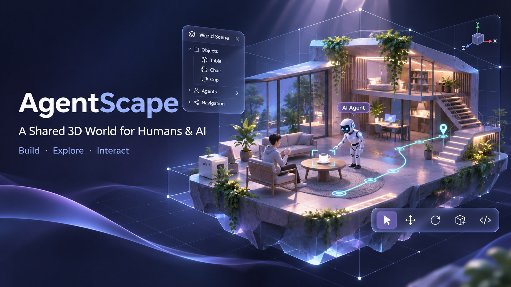

# AgentScape



> v2 已实现统一 Scene API、Recipe、完整项目包与三种 StylePack；`agentscape3d@1.0.0-beta.1` 已在官方 npm Registry 提供；此版本为 Beta，不等于当前 main 的开发版或稳定版。最新能力与限制见 [v1 契约](planning/public-contracts-v1.md)和[发布清单](docs/v2-release.md)。

**让人和 AI 能够操作同一个交互式 3D 世界。**

自由代码项目入口已加入开发工作区：运行多文件 Three.js、Shader 和持续逻辑，自定义可供 AI 发现的动作，保存代码与状态后重开。详见 [Code Project](docs/modules/code-project.md)，本地示例 `/examples/code-project/`；是否包含在现有 Beta 包中需以已发布 tarball 为准。

Three.js 渲染、Rapier 物理和 Recast 导航共享真实世界状态。人物能够走近物体、拾取和放置；请求成功与实际行为验证分开报告。

[在线 Studio](https://agentscape-virid.vercel.app/studio/) · [在线入门世界](https://agentscape-virid.vercel.app/starter/) · [English](README.en.md) · [入门示例](apps/starter/README.md) · [MCP](apps/mcp-server/README.md) · [贡献指南](CONTRIBUTING.md)

## 定位与当前产品

长期定位是面向智能体的世界编译器与运行时：把对三维世界的描述，变成一个人和 AI 都能操作、系统能够验证行为结果、能够保存和继续使用的交互式世界。近期产品是可接入 AI 工具的浏览器 3D 世界创作与运行工具，第一批服务对象是希望用 AI 创建交互场景、接入自己的 Agent、调试空间任务的开发者和技术创作者。

AgentScape Studio 是面向用户的默认工作台；SDK Starter 是学习和验证 SDK 的精简示例。运行能力与限制以 [v1 契约](planning/public-contracts-v1.md) 与 [候选版本能力矩阵](planning/candidate-capability-matrix.md) 为准；矩阵之外的世界与输入不承诺同等支持。

## 打开 AgentScape Studio

需要 Node.js 22.12+、npm 和现代浏览器（Studio 会自动选择可用渲染后端）。

```sh
git clone https://github.com/xiaoqianran/AgentScape.git
cd AgentScape
npm ci
npm run dev
```

Vite 会打开根路径 `/` 的 AgentScape 首页；从首页侧栏可进入 `/studio/` 完整世界工作台。Starter 教学页面仍可通过 `npm run starter` 在 `/starter/` 打开。

## 学习 SDK Starter

Starter 是独立的最小运行时示例，不包含 Studio 编辑器界面。它适合学习场景初始化、拾取、放置、保存与重开：

```sh
npm run starter
```

打开终端显示的 `/starter/` 页面，通常为 `http://127.0.0.1:5173/starter/`。

1. 点击拾取杯子，再放到桌上，等待实际验证结果。
2. 添加椅子并移动。
3. 下载世界 JSON，刷新页面，再打开下载的文件。

这个示例使用内置物体，无需模型密钥、生成服务或 Docker。安装依赖仍需要网络。Vercel 已提供公开静态预览：[Studio](https://agentscape-virid.vercel.app/studio/)、[入门世界](https://agentscape-virid.vercel.app/starter/)、[首页](https://agentscape-virid.vercel.app/)和[诊断台](https://agentscape-virid.vercel.app/observatory/)。另外开放[多文件代码世界](https://agentscape-virid.vercel.app/examples/code-project/)、[原生 Three.js 接入](https://agentscape-virid.vercel.app/examples/native-scene/)和[Three.js 代码资产示例](https://agentscape-virid.vercel.app/examples/three-code/)；部署配置及服务端适配器要求见[Vercel 部署说明](docs/deployment/vercel.md)。该预览不提供私有 MCP 服务，也不包含依赖本地服务的可选生成能力。

修改 `apps/starter/scene.json` 后刷新即可改变初始布局。支持 agent、cup、table、chair 四种内置物理资产；`main.js` 展示统一 SDK 的使用方式，包括浏览器帧循环。

## 接入已有 Three.js 项目

原生集成示例位于 [examples/native-scene](examples/native-scene/)，详细接入步骤、同一 Three.js 实例、物理碰撞体和宿主渲染循环约束见 [原生 Three.js 集成指南](docs/native-threejs-integration.md)和[原生注入架构契约](docs/native-threejs-architecture.md)。长期方向和阶段验收见[AgentScape 架构路线与决策锚点](docs/agentscape-architecture-roadmap.md)。此能力复用原来的 SceneFacade / Runtime，不接管宿主渲染器；原生项目保存/导出尚未实现。

实体交互、GLB 物理、乐器音频和实时生成的长期架构见[交互式世界运行时架构](docs/interactive-world-runtime-architecture.md)，后续安排见[七阶段路线](docs/interactive-world-runtime-architecture.md#后续阶段路线)，并可继续阅读[实体能力契约](docs/entity-capability-contract.md)、[GLB 交互物理管线](docs/glb-interactive-physics-pipeline.md)、[音频运行时与自适配音乐](docs/audio-runtime-and-adaptive-music.md)和[实时交互生成](docs/realtime-interactive-spawn.md)。

## 当前边界

首页在 `/`，Studio 在 `/studio/`，Starter 教学页在 `/starter/`，诊断台在 `/observatory/`。公开 npm 包 `agentscape3d` 分发 SDK、CLI 和 MCP 能力，不包含网站前端；npm Starter CLI 生成的是独立 SDK 示例工程，并不包含 Studio 工作台。现有 MCP 的独立世界、程序化资产、真实交互与可信恢复继续保留。本机代码资产默认可通过受限 QuickJS Worker 运行，无须 Docker；公网不可信源码执行必须配置操作系统隔离后端，否则明确拒绝。

SDK 已支持自包含 GLB Visual、受约束 Recipe、完整项目包和三种 StylePack；Starter 的按钮仍保持最小学习范围，Studio 提供风格切换。Scene Project 使用内置世界目录；SDK 默认纪念大厅，浏览器专属环境不支持 Headless。实体总数不固定为 32，激活、分页与存储有独立预算；YAML、任意 Shader 插件和通用压缩包上传不属于 v1。发布后可使用 `npm install agentscape3d` 和 `npx agentscape3d starter my-world`；发布前请参考 [SDK 本地打包说明](sdk/typescript/README.md)。

## 验证与贡献

```sh
npm run test:starter
npx playwright install chromium
npm run test:browser:starter
npm run check
```

欢迎提交示例、文档、翻译、可复现问题和代码改进。参与步骤见 [CONTRIBUTING.md](CONTRIBUTING.md)。底层六系统继续保留，不为入口简化复制世界状态。

代码采用 [MIT](LICENSE)；第三方模型、贴图和依赖的条款见 [THIRD_PARTY.md](THIRD_PARTY.md)，不能把代码许可证当成所有内容的许可证。
