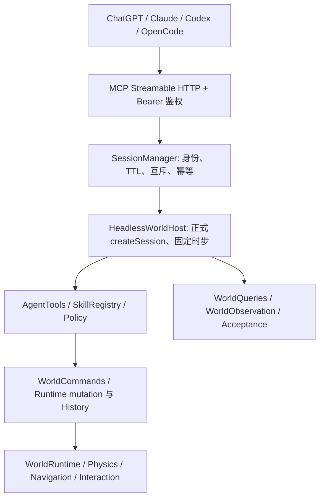

# AgentScape Remote MCP v0.3

自由代码项目可通过同一 Scene 工具发现并调用 `action:'custom'`、任意项目动作名和 JSON 参数；无验证器也允许执行，证据单列为未验证。现已新增统一 `action:'invoke'`：先 `scene_observe({target})` 读取 `capabilities`，再用 `scene_interact({interaction:{action:'invoke',target,name,actor?,partName?,args?}})` 调用已声明的资产关节、环境或代码项目动作。物理动作仍要求真实 Agent 和关节完成验证；保存重开不继承历史验证结果。代码、Shader、持续逻辑和作品迁移见 [Code Project](../../docs/modules/code-project.md)，示例入口 `/examples/code-project/`。源码由本地项目入口显式运行，MCP 不自动执行远端源码。`scene_capture(operation=capture, expectedRevision=...)` 可以只读获取正在运行项目的真实 JPEG 帧，并返回项目/Scene 修订号；只有当前源码修订正在运行且 Canvas 可读取时才允许，截图本身不做审美评价。Canvas 正在初始化时会短暂等待（最多约 2 秒）；若仍不可用则返回 `VISUAL_CANVAS_NOT_READY`，请针对同一运行修订重试。拒绝短边小于 32 像素的无效视觉证据。`studio_project(read)` 读取本地项目列表和已有共享列表缓存，不依赖共享仓库实时访问。`studio_files` 的 `preview_batch` 可对最多 32 项文件/资源操作预览差异但不发布；`apply_batch` 使用 `previewId` 和 `expectedRevision` 原子持久化，`discard_batch` 放弃预览，`undo_batch` 在无后续编辑时撤销最近一批；预览仅在当前 Studio 会话内有效。

新增容器隔离的程序化资产构建/发布、不可变版本与文件存储、可信世界保存恢复。原有 33 个工具继续兼容；新增 4 个 Studio Live Bridge 配对/会话工具，使用同一个 `agentscape-world` 连接。契约、示例、隔离设施和保存边界见 [PROGRAMMATIC-ASSETS.md](./PROGRAMMATIC-ASSETS.md)。

新增 scene_object_definition：将 AI 声明与真实 Three.js 节点结构分析结合，并通过 inspect/preview/apply/fork 对单实例进行版本化定点修正。详见 docs/modules/object-forge-refinement.md。当前 MCP 共 43 个工具。

Scene 工具为 `scene_thermal`（Asset Forge 材料实验查询、热功率和真实时步）、`scene_observe`、`scene_apply`、`scene_add_model`、`scene_interact`、`scene_job`、`scene_cancel`、`scene_verify`、`scene_save`、`scene_import`、`scene_object_definition`、`scene_set_style`。它们使用与 SDK/Studio 相同的 Scene 应用服务和 Runtime。`scene_interact` 立即返回 JobRef，由宿主推进模拟，调用方轮询任务并分别检查执行状态与验证证据。Recipe 可以直接作为 scene_add_model 的 model.asset 输入，无需生成 JavaScript。

**视觉布局验收（不等于物理验收）**：`scene_verify` 支持独立的 `visual-layout` criterion。用于静态展示、科学示意图和机械外观装配中有意相交或悬浮的 visual-only 资产。原始 WorldValidator 诊断完整保留，物理验收 `world-valid` 不变。

```js
scene_verify({
  worldSessionId: "...",
  criteria: [{
    id: "cart-layout",
    kind: "visual-layout",
    expectedOverlaps: [
      { object: "wheel", other: "axle", reason: "Wheel hub mounted on axle" }
    ],
    expectedFloating: []
  }]
})
```

每类声明最多 64 项，须包含对象 ID 和明确理由；重复、未知、未命中、非 visual 资产或已存在物理记录的声明均不允许通过。未声明的硬问题及警告仍使该 criterion 失败。返回的 `scope: "visual-layout-only"`、`validation`、`acknowledged` 与 `unexpectedHard/Advisory` 分开记录。这里仅承认有意的包围盒诊断，不能证明真实接触、关节连接或力学可行性。声明是当次验收参数，不修改世界结构、物理碰撞或保存格式；回导后需要重新传入并核验。该 criterion 已通过私有离线 Scene 的真实 MCP 往返测试；并非 WorldIR 的新物理编译约束，未承诺所有代码项目桥接模式都支持。


外部 GLB 可通过 `scene_add_model` 的 `mode: "prepare"` 生成能力候选（包含 `kinematics.hypotheses`）；若希望在不注册资产的情况下做隔离 Rapier 机械测试，可再次调用相同工具并设置 `mode: "screen"`、`model: {asset: 相同的 GLB source, proposalId: 上轮提案 ID, hypothesisIds?: 候选 ID[]}`。筛选逐方向返回 `trials` 和碰撞、稳定性报告，**即便机械测试通过也不会授权语义动作**。最后才使用默认 `mode: "add"`，附明确审核参数进行正式编译、物理验证和注册；配套 URDF 仍复用既有 Compiler Provider。接口、证据边界、Studio 审核入口和传输配额见 [资产交互化流程](../../docs/asset-interaction-pipeline.md)。

`scene_observe({ worldSessionId, target, actor? })` 等价于 SDK 的 `scene.inspect(target, { actor })`，返回资产或环境契约的统一能力说明。省略 target 时，场景观察的 `affordances` 包含这些对象的能力列表（最多 100 项，total 为总数）。能力在每次查询时读取当前状态，不额外保存对象状态。

每项动作包含 `parameters`、`execution`、`available` 和不可用时的 `reason`。未提供 actor 时，具身动作的 available 为 null，表示未检查可达性；提供后复用当前距离、遮挡及持有能力检查。available 只描述当前检查结果，不能替代执行后的碰撞、放置空间或关节完成验证。

`execution: interaction` 的动作统一调用 `scene_interact`；`world-action` 的环境契约现也可通过同一个 `scene_interact` 调用（open/close、turn_on/turn_off、pull_out/return、write），交由 Runtime 的 `WorldCommands.executeAffordance` 执行并核对后置状态。`editor` 使用 `scene_apply`，不代表 Agent 施力。环境契约的 `evidenceKind` 和 `physicsVerified=false` 不得冒充真实物理力学验证。Studio 的同一交互入口与验收边界参见 [统一交互](../../docs/studio-unified-interactions.md)。

通用物理操作不要求 Manifest 声明专用动作：动态刚体可发现 push/drag/rotate，真实滑动/旋转关节可发现 slide/rotateJoint。固定、持有、忙碌或缺少物理解算能力的对象会返回具体阻塞原因。物理元数据的 body 为资产声明，currentBody 为查询时的实际刚体类型。

| action | args | 执行和验证 |
| --- | --- | --- |
| push / drag | direction: 非零水平向量；distance: (0, 5] 米；maxForce?: (0, 1000] 牛，默认 100 | 从实际包围盒计算接触代理位置，通过 applyForce 驱动；验证位移、偏移和静止状态 |
| rotate | axis: 非零世界轴；angle: [-π, π] 弧度且非零；maxTorque?: (0, 1000] 牛米，默认 100 | applyTorque 驱动；验证真实姿态、轴向偏移与角速度 |
| slide / rotateJoint | part: 部件名；target: 绝对关节坐标，或 distance / angle: 相对变化量（二选一） | 仅驱动真实物理关节，检查限位并复用现有关节稳定、停滞与超时验证 |

例如 `scene_interact({ worldSessionId, requestId, interaction: { actor: "agent_01", target: "new_box", action: "push", args: { direction: [1, 0, 0], distance: 1 } } })` 返回 JobRef，随后使用 scene_job 查询结果。成功必须同时有终态 succeeded 和 verification.status=verified。实际证据区分 rigid-body-force、rigid-body-torque 和 joint-motor。

这些操作使用现有 1.5 米交互半径内的接触代理，推/拖会选择相应方向的可达站位；执行中持续复核距离、遮挡、持有状态和碰撞。它不是手指抓取，graspVerified 不会被标为 true。遇阻、偏移、超时或取消时保留真实的部分运动，报告未验证；不修改物体坐标来完成目标。箱子推动一米、不同质量、墙体阻挡、椅子拖动、轮子扭矩、滑动/旋转关节及取消均有 Runtime 验收，推动一米还覆盖真实 HTTP MCP 客户端。

保存和历史快照从 PhysicsSystem 读取部件的实际姿态及电机目标；恢复时按快照恢复，不另建关节状态缓存。实时物理操作与快照恢复路径分开。

注意：Headless MCP 没有渲染画布。调用 `scene_set_style` 成功后，返回的 `status=deferred`、`rendered=false`、`applied=null` 表示 StylePack 已记录到场景配置，**不表示实际画面已经切换或视觉渲染通过验收**。请在 Studio 或带图形渲染器的 SDK 客户端另行验证视觉效果；不要把无渲染器时的 deferred 状态误报为已应用。

`scene_import` 接受此前 `scene_save` 导出的完整 `bundle`，在当前私有世界或已连接 Studio 中导入，复用 Scene 的隔离校验、资源哈希和失败回滚；内联场景包受 8 MiB 配额约束，完整 MCP 消息受 10 MiB 上限约束。仅导入世界资产与状态，不恢复历史动作已验证证据。`world_save/world_restore` 仍只接受内置资产与同身份已发布的不可变资产；临时 `scene_add_model` 编译资产须使用 `scene_save/scene_import` 完成跨会话恢复。

`scene_save` 返回有资源字节和锁定哈希的完整项目包，仍受服务端导出配额限制。旧 world_export 的 JSON-only 语义保留。新版资产引用 `asset://sha256/<版本摘要>` 可以引用同一身份已发布的 pa_ 资产；未发布或其他身份的资产不能借此接入世界。

v0.2 的七个草稿接口和参数化 `world_verify` 保留；远程源码执行现已要求同一受限容器，不再仅依赖 Worker/WASM。原草稿工作流见 [AUTHORING.md](./AUTHORING.md)。

独立 Node.js 进程，为外部 Agent 提供可观察、可执行、可验证的私有 3D 世界。无需内部 LLM，不调用在线生成。SDK 固定为官方 MCP v2 2.4.0。



## 多 Studio 世界的安全选择

通过 MCP 调用 `studio_sessions_list({})`，读取当前身份能够访问的在线世界
`{worlds:[{worldSessionId,worldId,mode,status,connected}]}`。返回值不包含浏览器令牌，
也不会自动认领尚未绑定身份的 Studio 标签页。请使用返回的
`worldSessionId` 调用 `session_attach`、`scene_observe`、`scene_apply`
等工具；在同一浏览器开多个世界时，未指定 ID 的自动寻址会拒绝
`STUDIO_MULTIPLE_WORLDS`，而不是猜测目标。只有一个自动世界时保持原有自动连接。
已失联的会话在枚举时剔除；旧 ID 不可复用，重新连接需要重新列举。

## Windows 启动

在独立检出目录执行。Node.js 20+，本次使用本机 Node.js；安装依赖不会加载 Studio 私有配置。

```powershell
cd D:\a_programming_list\A-Python-Project\wk08\AgentScape
npm ci
$credential = [Convert]::ToHexString([Security.Cryptography.RandomNumberGenerator]::GetBytes(32))
$env:AGENTSCAPE_MCP_TOKENS = ConvertTo-Json -Compress -AsArray @{ identity = 'my-agent'; token = $credential }
npm run mcp:serve
```

客户端请求头配置 `Authorization: Bearer <credential>`，URL 为 `http://127.0.0.1:39015/mcp`。凭据需通过私有配置安全交给客户端。服务不打印凭据。环境变量包含 JSON 数组，可为不同客户端配置不同 identity/token。相同 identity 代表同一访问主体，能够共享该主体创建的世界。不要复用 Studio 或模型 API 密钥。

只监听 127.0.0.1，端口冲突直接失败。Ctrl+C 关闭全部世界。默认快照写入当前检出的 `.mcp-sessions/<worldSessionId>/`，不会加载 Studio 存档。工作目录必须是独立检出。

## 工具接口

| 工具 | 参数 | 结果 |
|---|---|---|
| session_create | template: monument-hall（默认） | worldSessionId、tick、状态；预置 agent_01 / cabinet_01 / cup_01 / table_01，杯子位于柜内 |
| session_status | worldSessionId | 世界与执行状态、闲置到期时间 |
| session_close | worldSessionId | 取消执行并释放 Runtime |
| world_observe | worldSessionId、offset=0、limit=25（最多50） | 有界对象、Agent、空间关系和分页游标 |
| object_inspect | worldSessionId、id | 对象与关节、空间证据 |
| skills_list | worldSessionId | 六个审核动作及各自 JSON Schema |
| action_execute | worldSessionId、skill、args、requestId（UUID） | state、真实 Runtime result、steps、tick |
| world_verify | worldSessionId | verified/unverified、逐项验收证据、持物状态 |
| world_export | worldSessionId | fileName、bytes、snapshot、scope=scene-json-only |

### Studio 实时世界的轻量观察与批量编辑

Studio 已自动连接时，`scene_observe` 可不传 `worldSessionId`（仅允许一个自动连接的本地世界）。默认返回完整对象、交互能力及空间关系；传入 `target` 则检查单个对象；传入 `limit`（1–1000）和可选 `offset` 则返回轻量 `agentscape.scene-object-page`，包含 `total`、`objects` 和 `nextOffset`，不会展开全局空间关系。`offset` 必须配合 `limit`，且分页参数不能与 `target` 同时使用。

批量编辑使用 `scene_apply`，一个 UUID `requestId` 对应最多 32 个 `operations`。Runtime 仍逐条执行，失败时保留已执行操作并返回 `applied`、`failed`、`notRun`；这**不是原子回滚事务**。SceneGraph 在一次批量调用结束后合并关系更新，避免无意义的重复全量重建。大量相同资产推荐先注册资产，再使用 `scene_apply` 按引用批量实例化。

场景关系 CPU 基准：`node dev/scripts/benchmark-scene-graph.mjs`。它只测试稀疏对象的 SceneGraph，不能作为 MCP 往返、GPU、物理或导航性能指标。

MCP Transport 使用无状态 HTTP；没有 MCP 协议会话 ID，worldSessionId 专属于世界生命周期。每个工具调用仍要求 Bearer 鉴权。SDK 处理协议消息及参数验证；工具执行错误返回 isError 和脱敏错误码。

动作白名单：spawnAsset、moveObject、navigateTo、approachAndInteract、approachAndPickup、approachAndPlace。参数完全遵循 skills_list 返回的 Schema；拒绝未知字段。初始资产为本地 agent / cabinet / cup / table，也允许实例化当前会话已编译注册的创作资产。动作接口不能指定 URL 或磁盘目录；Three.js 代码只能通过 authoring_execute 在受限引擎内执行。profile、actor 的授权身份均由服务端固定，actorId 只是世界内对象 ID。

按顺序调用（每次动作生成独立 requestId；重试相同动作使用原 ID）：

```json
{"skill":"approachAndInteract","args":{"actorId":"agent_01","targetId":"cabinet_01","action":"open"}}
{"skill":"approachAndPickup","args":{"actorId":"agent_01","targetId":"cup_01"}}
{"skill":"approachAndPlace","args":{"actorId":"agent_01","supportId":"table_01","surfaceId":"top"}}
```

以上动作参数还需添加 worldSessionId 和 requestId。之后执行 world_verify、world_export、session_close。调用成功不代表动作成功：读取 state（verified / unverified / blocked / failed / requested）和 result 中的最终证据。请求型返回不提升为 verified。

单世界只允许一个操作，包括读取、验收和导出；并发返回 SESSION_BUSY。Runtime 负责事务、回滚和 History。requestId 绑定动作和参数，冲突拒绝；会话内最多保存256个动作幂等记录，不丢弃后重放。

## 安全与资源

默认最多4个世界，空闲15分钟回收；每世界64个对象、256次动作；单动作最多12000个 1/60 秒模拟步和30秒墙钟时间。每12步让出事件循环。取消/超时重复终止 Runtime interaction/locomotion，并给予最多240步清理；无法收敛则关闭该 Host，禁止继续动作。

两个 MCP 端点完整 HTTP 请求及响应默认最多 10 MiB，每身份每分钟 600 次请求；Host 白名单默认 localhost/127.0.0.1，Origin 默认全部拒绝（无 Origin 的非浏览器客户端可用）。headers 10 秒、request 120 秒接收超时（不是工具执行时限）。快照最多 8 MiB，临时文件 JSON 复核后原子 rename；客户端不能指定路径。快照是 SceneSerializer JSON，不包含完整 GLB/纹理作品包。

对象和动作预算限制会话增长；当前 Node.js 同进程承载多个 Runtime，不提供每会话操作系统级硬内存隔离。需要硬内存限制时应采用受限进程/容器部署，不应将本版宣传为任意用户公网沙箱。

进程崩溃后内存世界丢失，启动时不会恢复任何旧世界、鉴权所有权或临时快照；旧的快照和未发布 .tmp 文件可能留在私有目录，须由服务拥有者离线清理。v0.1 不支持快照导入，错误导入不构成开放接口。

## 远程连接

通过可信 TLS 反向代理或隧道转发到 127.0.0.1:39015，保留 Authorization。代理应将上游 Host 设为 localhost；浏览器客户端需由部署代码向 startServer 的 security.origins 传入明确完整 Origin，禁止通配。默认 CLI 不开放跨域浏览器访问。不要暴露本地端口。

这是私有 Bearer 部署，不包含 OAuth 授权发现；要求 OAuth 的托管客户端需要额外授权层。已通过 PC2 AgentDock 的真实工具调用验证完整工作流，部署详情见 DEPLOYMENT-PC2.md；其他客户端各自的直连配置尚未验证。

## 文件职责与验证

- main.mjs：独立 HTTP 启动及关闭、官方 SDK Transport。
- registerTools.js：九工具、严格动作参数 Schema、调用映射。
- security.js：私有身份鉴权、Host/Origin、请求体和频率预算。
- SessionManager.js：所有权、互斥、幂等、TTL、原子导出。
- HeadlessWorldHost.js：复用 createSession/WorldBuilder/AgentTools，独立模拟驱动、动作证据和释放。
- tasks.jsonl：阶段任务；acceptance-evidence.json：真实 MCP 验收记录。
- tests/mcp/：官方 HTTP Client 物理任务、隔离、安全和生命周期自动断言。
- 根 package.json/lock：固定 MCP 依赖和启动/测试脚本；.gitignore：排除私有会话目录。

```powershell
npm run test:mcp
npm run check
```

测试覆盖未鉴权、Origin、请求体限制、频率限制、端口冲突、跨身份隔离、未知 Session、非法参数、白名单、幂等冲突、互斥、取消、超时、异常解锁、TTL、关闭释放、导出预算、原子发布和残留文件不恢复。真实任务使用 Rapier、Recast、柜体 GLB；没有在线模型调用。

已知语义限制：资产/布局准入仍可能 provisional；这与真实动作及最终支撑关系 verified 是不同证据。pickup 为 kinematic attachment，不证明夹持力。未提供截图、在线生成、Studio 同步、多用户公网账号、完整作品包迁移。

机械资产 v1：scene_add_model 的 model.asset 可提交 agentscape.mechanical-draft JSON（几何节点、旋转铰链、滑轨），先经过 GLB 编译与隔离物理验证。详见 [机械资产创建工作台](../../docs/capabilities/mechanical-asset-workbench.md)。

Studio Live Bridge：调用 studio_pair_create 取得一次性配对码，然后在本机 Studio 的「MCP 连接」中明确授权；通过返回的 worldSessionId 使用既有 Scene 工具操作浏览器当前世界。切换世界自动撤销连接。完整说明见 [Studio Live Bridge](../../docs/mcp-studio-live-bridge.md)。

本机 Studio MCP 自动连接默认开启：打开 Studio 后由浏览器自动注册当前世界，认证 MCP 客户端可省略 Scene 工具的 worldSessionId；手动配对仍可在高级设置中使用。见 [自动连接说明](../../docs/mcp-studio-auto-connect.md)。

项目与全局资产：scene_save/scene_import 保存 Object Forge 可编辑声明和 revision；asset_publish_project 发布当前用户全局不可变版本；scene_object_definition 的 fork 从全局资产复制当前项目可编辑定义。详见 docs/modules/project-global-assets.md。

## MCP 工具契约（分类版）

普通 /mcp 与受限 /agent-mcp 使用同一组分类工具，通过原有 Studio Bridge project 方法转发；不新增世界实例或重复底层能力。

| 工具 | 操作 |
| --- | --- |
| studio_project | read、create、create_world、open、run、save、close |
| studio_files | write、patch、file_read、file、resource、preview_batch、apply_batch、discard_batch、undo_batch |
| scene_query | search、inspect、inspect_batch |
| scene_capture | capture、suggest_views |
| scene_timeline | command=status/pause/resume/step（无需 operation） |

迁移：此前 studio_project(operation=write,create=true) 改为 studio_project(operation=create)，保留 name/source/project；修改现有源码使用 studio_files(operation=write)，观察和截图改用对应分类工具。旧混合 operation 不再注册，不提供重复别名。运行后使用返回的 revision/runtimeId，观察结果提供 sceneRevision/objectUuid，后续请求绑定这些标识。所有实际运行场景的查询、截图和时间控制必须传 expectedRevision。

受限项目模式只允许 studio_project read/run/save，studio_files 不接受 create；五类工具均由服务端绑定预定 worldSessionId 和 expectedProjectId。修改权限以实际 Zod 校验为准，不仅隐藏 Schema 字段。注册语义实体和动作仍使用 scene_observe / scene_interact，客观条件验收使用 scene_verify。截图不是验收结论。Code Project 的 scene_verify 可选 snapshot=inspect 或 visual：在同一次同步采样中返回后置条件、原生根节点观察及可选 JPEG，并附 projectId/projectRevision/runtimeId/sceneRevision/frame/tick；非代码世界不支持此选项。Canvas 暂未就绪时重试整组采样，不混合不同帧。普通 scene_verify 契约不变。

### Scene navigation diagnosis

`scene_navigation({actor,position})` is a read-only live route query with provisional, actor-eligible registered articulation recovery candidates. Native numerical joints use hypothetical collider poses at declared limits and bounded external sweep checks; managed open diagnosis retains its obstacle-suppression assumption. No solver state or history is changed. Use the returned `recommendation.interaction` only for an authorized goal with `scene_interact`, await `scene_job`, then query `scene_navigation` again. A predicted path is not evidence of real passage. Native/mixed ON and SUPPORTS criteria are verified from current geometry, actual supporting contacts and motion rather than a past placement receipt.

Serial native barriers can now return a provisional `recommendation.progress` of kind `partial-route-progress` even while `counterfactual.reachable` is false. This is measured advancement of the same partial route, not destination reachability. Native candidates also require a real current-world joint approach preflight. Execute one verified interaction, then re-query; do not batch hypothetical recoveries or assume eventual completion. Complete-route unlocks have priority. The progress heuristic is bounded and does not search arbitrary joint combinations.


## 大型资源传输（OpenAI 风格）

独立 HTTP 接口使用相同 Bearer 身份、Host/Origin 检查及速率限制。不把二进制编码成 MCP JSON。以下接口为 AgentScape 自有协议，并非 OpenAI Uploads API 的线缆兼容实现。

| HTTP | 输入 / 输出 |
| --- | --- |
| POST /uploads | JSON {bytes, sha256?} → upload ID |
| GET /uploads/:id | 当前接收字节数、分片及过期时间 |
| POST /uploads/:id/parts | 原始二进制请求体 → part ID、字节数、SHA-256 |
| POST /uploads/:id/complete | JSON {partIds: [...]}（按目标文件顺序）→ file ID |
| POST /uploads/:id/cancel | 取消并释放暂存空间 |
| GET /files/:id | 文件元信息 |
| GET /files/:id/content | 流式下载，Content-Length 与 X-Content-SHA256 |
| DELETE /files/:id | 删除未被使用的文件 |

默认每文件 8,000,000,000 字节、每分片 64,000,000 字节、上传有效期 1 小时、最多 1024 分片。服务级暂存与世界块共享 24 GB 磁盘配额，最多 128 个文件/上传和 4 个并发传输。单个上传串行写入分片，完成时按指定顺序逐块重新校验，无需拼接整份文件。通过 startServer 的 security、managerOptions、transferOptions 可调整默认值。已完成文件仅在当前服务进程有效，正常关闭清理暂存；尚不支持重启恢复、跨进程共享或自动清理崩溃遗留目录。

私有离线世界可调用 `scene_save({worldSessionId, format: "world-file"})` 获取 fileId、bytes、sha256，再通过 HTTP 下载 .asworld；`scene_import({worldSessionId, requestId, fileId})` 通过已有 WorldArchive/WorldStorage 校验并事务提交。导入后的资源块保留到世界替换或关闭，不受上传文件删除影响。使用每次操作独立的磁盘块存储；不接受依赖外部未提供资源块的 linked 包。Studio 桥接不支持此文件模式，原 inline 模式仍保留。.asworld 保存世界数据而非 Object Forge 编辑声明，后者使用 inline 包。资产解码预算和世界激活预算保持独立，不承诺单个 8 GB GLB 可加载。

验证：`npx vitest run tests/mcp/world-transfer.test.js tests/mcp/http-security.test.js`；可选本机压力测试 `node dev/scripts/benchmark-mcp-transfer.mjs`（最大 1 GiB 暂存，完成后删除测试数据）。
