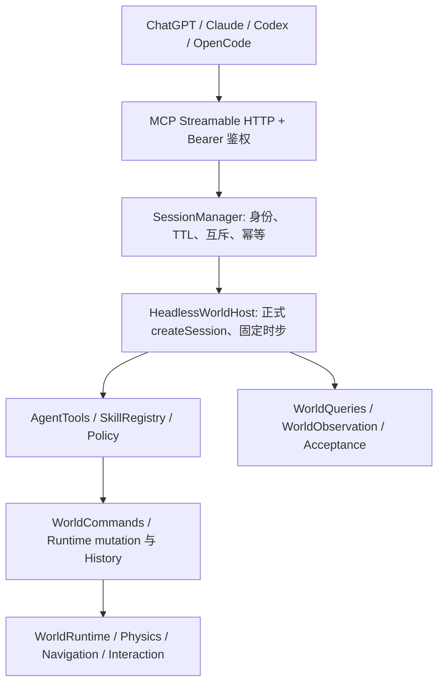

# AgentScape Remote MCP v0.2

新增通过隔离 Three.js 构建草稿并晋升到世界的七个接口，以及参数化 `world_verify`。当前共十六工具。工作流、执行预算和保存边界见 [AUTHORING.md](./AUTHORING.md)。

独立 Node.js 进程，为外部 Agent 提供可观察、可执行、可验证的私有 3D 世界。无需内部 LLM，不调用在线生成。SDK 固定为官方 MCP v2 2.4.0。



## Windows 启动

在独立检出目录执行。Node.js 20+，本次使用本机 Node.js；安装依赖不会加载 Studio 私有配置。

```powershell
cd D:\a_programming_list\A-Python-Project\wk08\AgentScape
npm ci
$credential = [Convert]::ToHexString([Security.Cryptography.RandomNumberGenerator]::GetBytes(32))
$env:AGENTSCAPE_MCP_TOKENS = ConvertTo-Json -Compress -AsArray @{ identity = 'my-agent'; token = $credential }
npm run mcp:serve
```

客户端请求头配置 `Authorization: Bearer <credential>`，URL 为 `http://127.0.0.1:39015/mcp`。凭据需通过私有配置安全交给客户端。服务不打印凭据。环境变量包含 JSON 数组，可为不同客户端配置不同 identity/token。相同 identity 代表同一访问主体，能够共享该主体创建的世界。不要复用 Studio 或模型 API 密钥。

只监听 127.0.0.1，端口冲突直接失败。Ctrl+C 关闭全部世界。默认快照写入当前检出的 `.mcp-sessions/<worldSessionId>/`，不会加载 Studio 存档。工作目录必须是独立检出。

## 工具接口

| 工具 | 参数 | 结果 |
|---|---|---|
| session_create | template: monument-hall（默认） | worldSessionId、tick、状态；预置 agent_01 / cabinet_01 / cup_01 / table_01，杯子位于柜内 |
| session_status | worldSessionId | 世界与执行状态、闲置到期时间 |
| session_close | worldSessionId | 取消执行并释放 Runtime |
| world_observe | worldSessionId、offset=0、limit=25（最多50） | 有界对象、Agent、空间关系和分页游标 |
| object_inspect | worldSessionId、id | 对象与关节、空间证据 |
| skills_list | worldSessionId | 六个审核动作及各自 JSON Schema |
| action_execute | worldSessionId、skill、args、requestId（UUID） | state、真实 Runtime result、steps、tick |
| world_verify | worldSessionId | verified/unverified、逐项验收证据、持物状态 |
| world_export | worldSessionId | fileName、bytes、snapshot、scope=scene-json-only |

MCP Transport 使用无状态 HTTP；没有 MCP 协议会话 ID，worldSessionId 专属于世界生命周期。每个工具调用仍要求 Bearer 鉴权。SDK 处理协议消息及参数验证；工具执行错误返回 isError 和脱敏错误码。

动作白名单：spawnAsset、moveObject、navigateTo、approachAndInteract、approachAndPickup、approachAndPlace。参数完全遵循 skills_list 返回的 Schema；拒绝未知字段。初始资产为本地 agent / cabinet / cup / table，也允许实例化当前会话已编译注册的创作资产。动作接口不能指定 URL 或磁盘目录；Three.js 代码只能通过 authoring_execute 在受限引擎内执行。profile、actor 的授权身份均由服务端固定，actorId 只是世界内对象 ID。

按顺序调用（每次动作生成独立 requestId；重试相同动作使用原 ID）：

```json
{"skill":"approachAndInteract","args":{"actorId":"agent_01","targetId":"cabinet_01","action":"open"}}
{"skill":"approachAndPickup","args":{"actorId":"agent_01","targetId":"cup_01"}}
{"skill":"approachAndPlace","args":{"actorId":"agent_01","supportId":"table_01","surfaceId":"top"}}
```

以上动作参数还需添加 worldSessionId 和 requestId。之后执行 world_verify、world_export、session_close。调用成功不代表动作成功：读取 state（verified / unverified / blocked / failed / requested）和 result 中的最终证据。请求型返回不提升为 verified。

单世界只允许一个操作，包括读取、验收和导出；并发返回 SESSION_BUSY。Runtime 负责事务、回滚和 History。requestId 绑定动作和参数，冲突拒绝；会话内最多保存256个动作幂等记录，不丢弃后重放。

## 安全与资源

默认最多4个世界，空闲15分钟回收；每世界64个对象、256次动作；单动作最多12000个 1/60 秒模拟步和30秒墙钟时间。每12步让出事件循环。取消/超时重复终止 Runtime interaction/locomotion，并给予最多240步清理；无法收敛则关闭该 Host，禁止继续动作。

HTTP 请求体最多64 KiB，每身份每分钟120次请求；Host 白名单默认 localhost/127.0.0.1，Origin 默认全部拒绝（无 Origin 的非浏览器客户端可用）。headers 10秒、request 35秒超时。快照最多4 MiB，临时文件 JSON 复核后原子 rename；客户端不能指定路径。快照是 SceneSerializer JSON，不包含完整 GLB/纹理作品包。

对象和动作预算限制会话增长；当前 Node.js 同进程承载多个 Runtime，不提供每会话操作系统级硬内存隔离。需要硬内存限制时应采用受限进程/容器部署，不应将本版宣传为任意用户公网沙箱。

进程崩溃后内存世界丢失，启动时不会恢复任何旧世界、鉴权所有权或临时快照；旧的快照和未发布 .tmp 文件可能留在私有目录，须由服务拥有者离线清理。v0.1 不支持快照导入，错误导入不构成开放接口。

## 远程连接

通过可信 TLS 反向代理或隧道转发到 127.0.0.1:39015，保留 Authorization。代理应将上游 Host 设为 localhost；浏览器客户端需由部署代码向 startServer 的 security.origins 传入明确完整 Origin，禁止通配。默认 CLI 不开放跨域浏览器访问。不要暴露本地端口。

这是私有 Bearer 部署，不包含 OAuth 授权发现；要求 OAuth 的托管客户端需要额外授权层。已通过 PC2 AgentDock 的真实工具调用验证完整工作流，部署详情见 DEPLOYMENT-PC2.md；其他客户端各自的直连配置尚未验证。

## 文件职责与验证

- main.mjs：独立 HTTP 启动及关闭、官方 SDK Transport。
- registerTools.js：九工具、严格动作参数 Schema、调用映射。
- security.js：私有身份鉴权、Host/Origin、请求体和频率预算。
- SessionManager.js：所有权、互斥、幂等、TTL、原子导出。
- HeadlessWorldHost.js：复用 createSession/WorldBuilder/AgentTools，独立模拟驱动、动作证据和释放。
- tasks.jsonl：阶段任务；acceptance-evidence.json：真实 MCP 验收记录。
- tests/mcp/：官方 HTTP Client 物理任务、隔离、安全和生命周期自动断言。
- 根 package.json/lock：固定 MCP 依赖和启动/测试脚本；.gitignore：排除私有会话目录。

```powershell
npm run test:mcp
npm run check
```

测试覆盖未鉴权、Origin、请求体限制、频率限制、端口冲突、跨身份隔离、未知 Session、非法参数、白名单、幂等冲突、互斥、取消、超时、异常解锁、TTL、关闭释放、导出预算、原子发布和残留文件不恢复。真实任务使用 Rapier、Recast、柜体 GLB；没有在线模型调用。

已知语义限制：资产/布局准入仍可能 provisional；这与真实动作及最终支撑关系 verified 是不同证据。pickup 为 kinematic attachment，不证明夹持力。未提供截图、在线生成、Studio 同步、多用户公网账号、完整作品包迁移。
